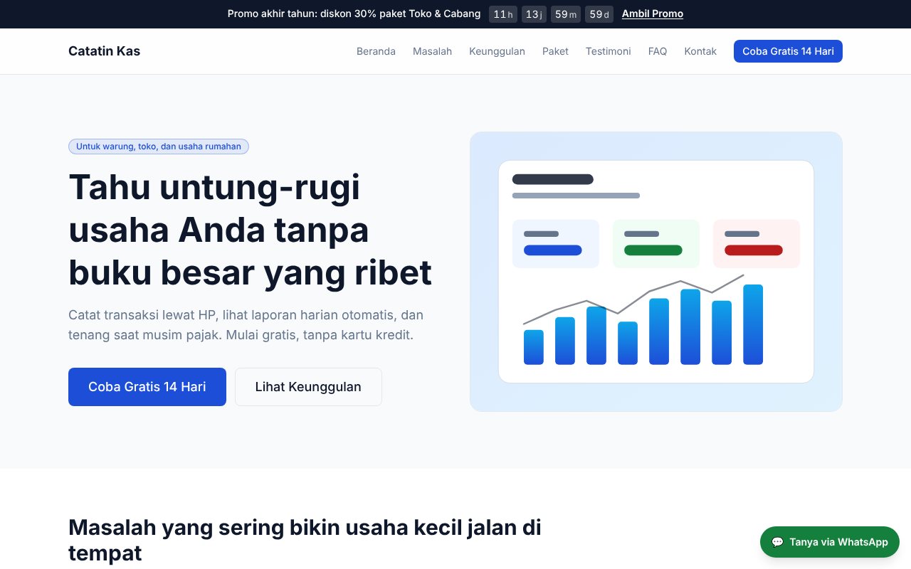
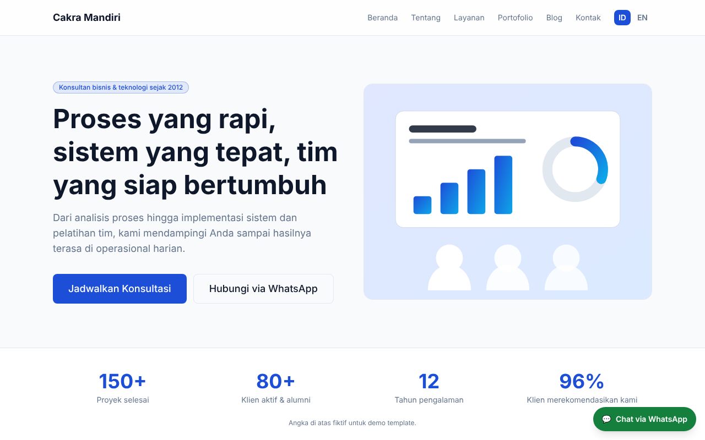
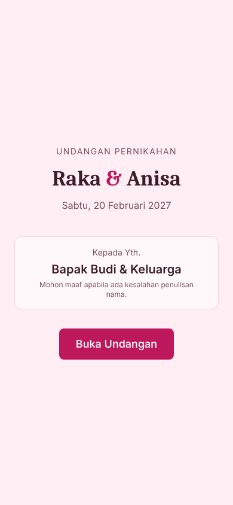
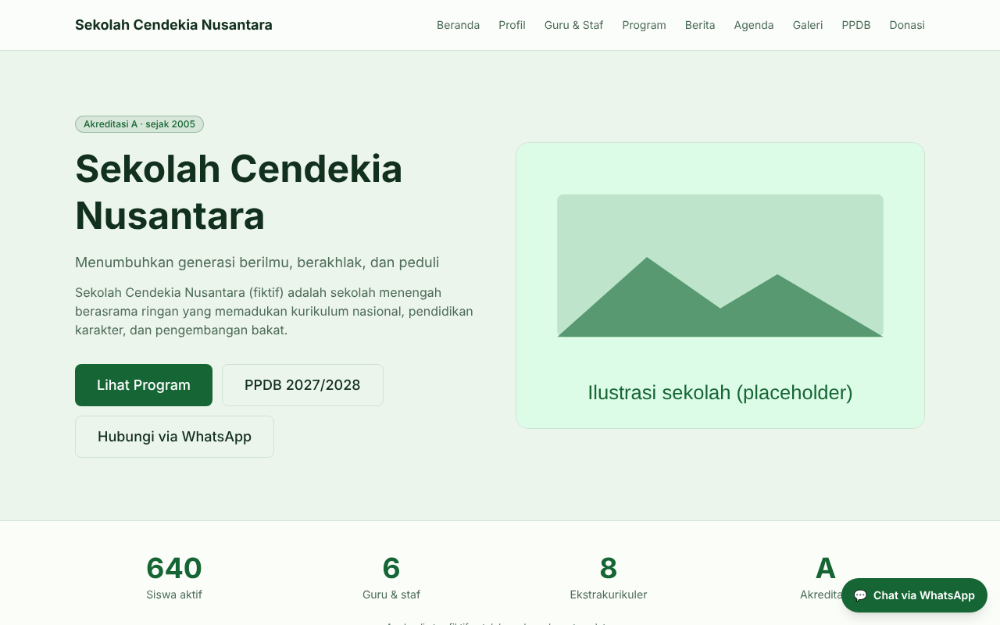
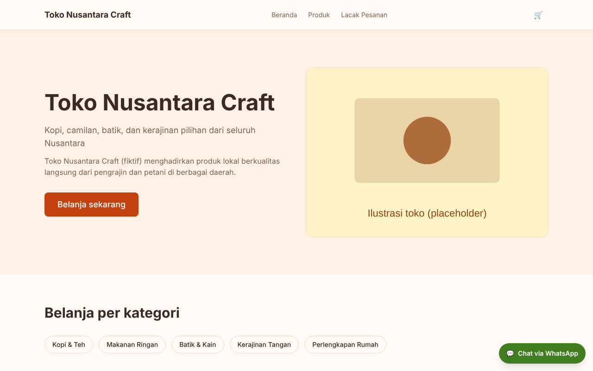
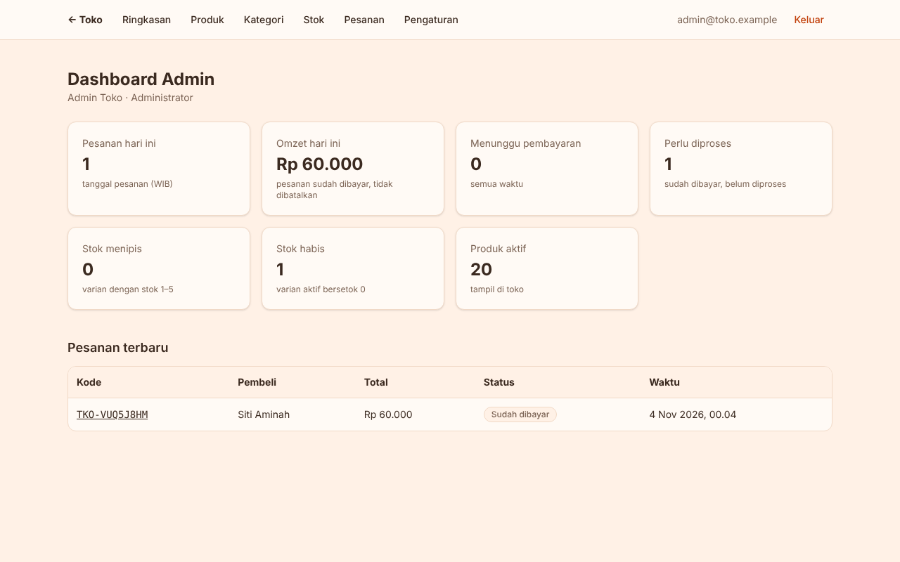

# 5 Template Website Siap Jual

Monorepo berisi **5 template website berbahasa Indonesia** yang siap pakai atau tinggal dimodifikasi. Semua brand, nama, produk, rekening, dan data pada template ini **fiktif** (gambar demo = SVG placeholder buatan sendiri). Dibangun dengan Next.js 16, React 19, TypeScript, Tailwind CSS v4, Prisma + SQLite (app ber-DB), dan diuji dengan Vitest + Playwright.

| App | Port | Cocok untuk | Fitur utama | Database | Panel admin |
|---|---|---|---|---|---|
| [`apps/landing-page`](apps/landing-page) | 3001 | Produk/jasa tunggal | Hero, fitur, paket harga, testimoni, FAQ, form lead (honeypot + rate limit), WhatsApp | SQLite (lead) | Ya (password) — daftar lead + ekspor CSV |
| [`apps/company-profile`](apps/company-profile) | 3002 | Perusahaan/agensi | Layanan, portofolio (filter), blog Markdown, kontak, **dwibahasa ID/EN**, SEO lengkap | SQLite (pesan) | Ya (password) — pesan masuk + CSV |
| [`apps/undangan`](apps/undangan) | 3003 | Pernikahan, aqiqah, khitan | Cover, mempelai, acara + countdown, galeri, RSVP, ucapan, amplop digital, 3 tema | SQLite | Ya (password) — tamu/RSVP/ucapan |
| [`apps/sekolah`](apps/sekolah) | 3004 | Sekolah/pesantren/yayasan | Profil, guru, berita, agenda, galeri, **PPDB online**, **donasi/infaq**, CRUD konten | SQLite | Ya (NextAuth, peran ADMIN/EDITOR) |
| [`apps/toko-online`](apps/toko-online) | 3005 | Toko UMKM | Katalog (filter/cari/urut), varian & stok, keranjang, checkout dengan voucher & ongkir, lacak pesanan, bukti bayar, invoice, CSV | SQLite | Ya (NextAuth, peran ADMIN/STAFF) |

Paket bersama: [`packages/config`](packages/config) (tsconfig, ESLint, Prettier, Playwright, tema), [`packages/ui`](packages/ui) (komponen UI), [`packages/core`](packages/core) (validasi, sanitasi, rate limit, honeypot, unggahan aman, header keamanan).

## Tampilan

| Landing Page | Company Profile | Undangan |
|---|---|---|
|  |  |  |

| Sekolah | Toko Online | Admin Toko |
|---|---|---|
|  |  |  |

Screenshot lengkap tiap app ada di `apps/<app>/docs/screenshots/` dan ditampilkan di README masing-masing.

## Memulai

Prasyarat: Node 22 (`nvm use`), npm 10.

```bash
npm ci
# Salin & isi env tiap app (password admin ≥ 12 karakter, NEXTAUTH_SECRET ≥ 32 karakter acak):
for a in landing-page company-profile undangan sekolah toko-online; do cp apps/$a/.env.example apps/$a/.env; done
#   buat rahasia:  node -e "console.log(require('crypto').randomBytes(32).toString('base64url'))"
npm run setup      # prisma generate + migrate + seed demo (app ber-DB)
npm run dev:all    # jalankan semua app: http://localhost:3001 … 3005
```

Skrip lain (semuanya melewati app yang belum ada): `npm run build:all`, `npm test` (unit), `npm run test:e2e` (Playwright), `npm run test:all` (keduanya), `npm run lint`, `npm run typecheck`, `npm run format:check`.

## Akun demo

Tidak ada kredensial bawaan: akun dibuat dari env saat `npm run setup`, dan login admin otomatis **nonaktif** bila rahasianya kosong (fail closed).

| App | Login admin | Diatur di `.env` |
|---|---|---|
| Landing Page | `/admin/login` — hanya password | `ADMIN_PASSWORD`, `ADMIN_SESSION_SECRET` (≥ 32 karakter) |
| Company Profile | `/admin/login` — hanya password | `ADMIN_PASSWORD`, `ADMIN_SESSION_SECRET` |
| Undangan | `/admin` — hanya password | `ADMIN_PASSWORD`, `ADMIN_SESSION_SECRET` |
| Sekolah | `/admin/login` — `admin@sekolah.example` (ADMIN), `editor@sekolah.example` (EDITOR) | `ADMIN_PASSWORD`, `EDITOR_PASSWORD`, `NEXTAUTH_SECRET` |
| Toko Online | `/admin/login` — `admin@toko.example` (ADMIN), `staf@toko.example` (STAFF) | `ADMIN_PASSWORD`, `STAFF_PASSWORD`, `NEXTAUTH_SECRET` |

Voucher demo toko: `HEMAT10`, `POTONG25K` (lihat [README toko](apps/toko-online/README.md)).

## Keamanan & kualitas (ringkas)

- Header keamanan (CSP ketat, `nosniff`, `frame-ancestors 'none'`, …) di semua app; tidak ada permintaan ke domain luar (font lokal/system, gambar SVG lokal).
- Validasi masukan di server (Zod), sanitasi teks, honeypot + rate limit pada form publik, unggahan divalidasi **magic bytes** (SVG/GIF ditolak), CSV anti-formula-injection.
- Admin: login fail-closed tanpa rahasia, cookie `httpOnly` + `SameSite=Strict`, rate limit login. Pada **sekolah** dan **toko** (NextAuth) sesi juga dicek ulang ke database di tiap halaman/aksi dan hak berasal dari peran di DB, plus anti open redirect dan anti-enumerasi akun.
- Toko: harga, ongkir, diskon, dan total **dihitung ulang di server** (klien tidak dipercaya); stok & voucher dikunci atomik.
- Tiap app punya e2e (Playwright) untuk: tanpa error konsol/CSP, tanpa overflow di 360/768/1280 px, dan aksesibilitas (heading, landmark, label, fokus, kontras WCAG AA); app ber-admin juga menguji otorisasi.

Panduan memodifikasi template: [`docs/CARA-MODIF.md`](docs/CARA-MODIF.md). Rencana pengerjaan: `PLAN.md`; status: `PROGRESS.md`. Lisensi aset demo: [`CREDITS.md`](CREDITS.md).

> Hasil CI GitHub dicek manual oleh pemilik repo.
