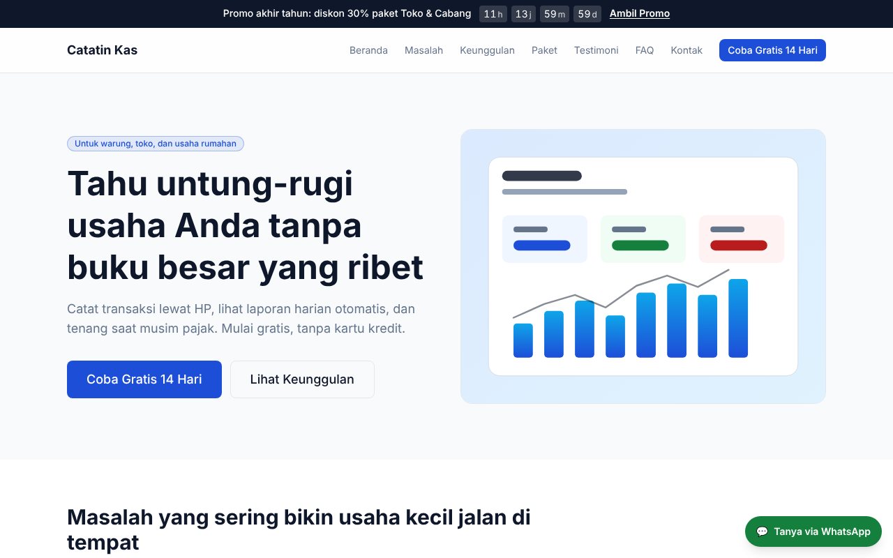
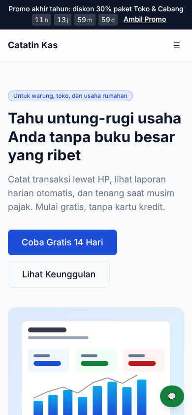
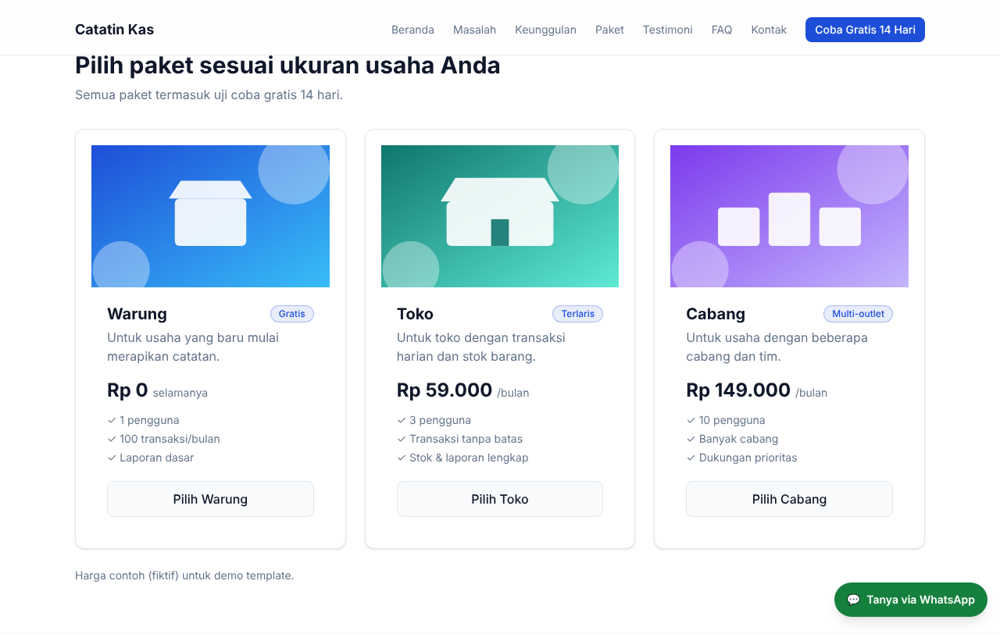
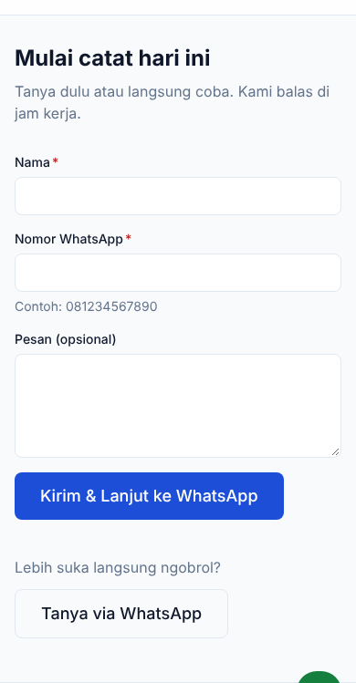
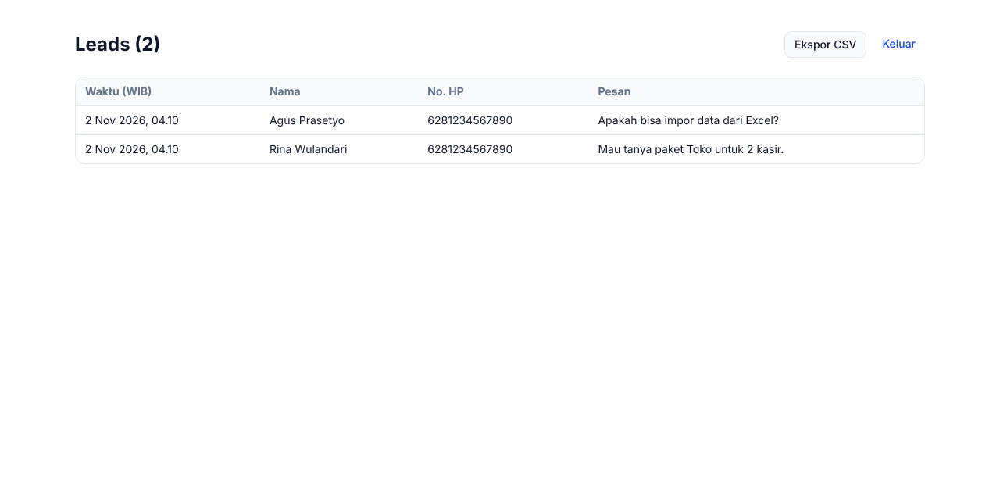

# Landing Page — "Catatin Kas" (demo)

Template landing page untuk produk/jasa, siap dimodifikasi. Brand, harga, dan testimoni di dalamnya **fiktif**.

| Desktop | Mobile |
|---|---|
|  |  |
|  |  |



## Fitur

- Hero, masalah–solusi, keunggulan, paket harga, testimoni, FAQ, CTA penutup, banner promo + countdown (opsional).
- Form lead: validasi Zod, honeypot, rate limit, cek Origin → tersimpan di SQLite (Prisma 7) → pengunjung diarahkan ke WhatsApp dengan pesan terisi.
- `/admin/leads`: login password (env), daftar lead, ekspor CSV (aman dari formula injection).
- SEO: metadata, Open Graph (gambar dibuat lokal saat build), `robots.txt`, `sitemap.xml`, JSON-LD.
- 3 tema warna, GA4/Meta Pixel opsional lewat env, security headers + CSP.

## Menjalankan

```bash
# dari root monorepo
npm ci
cp apps/landing-page/.env.example apps/landing-page/.env   # lalu sesuaikan
npm run setup -w @tpl/landing-page                           # prisma generate + migrasi
npm run dev -w @tpl/landing-page                             # http://localhost:3001
```

Admin: buka `http://localhost:3001/admin/login`, password = `ADMIN_PASSWORD` di `.env`.

Produksi: `npm run build -w @tpl/landing-page && npm run start -w @tpl/landing-page`.

## Cara modifikasi

| Ingin mengubah | Di mana |
|---|---|
| Semua teks, menu, paket, testimoni, FAQ, nomor WhatsApp | `content/site.ts` |
| Promo & countdown (aktif/tidak, tanggal berakhir) | `site.promo` di `content/site.ts` |
| Tema warna (`netral` / `hangat` / `hijau`) | `site.theme` atau env `NEXT_PUBLIC_THEME` |
| Gambar & ilustrasi | `public/img/` (SVG placeholder — ganti dengan milik Anda) |
| Favicon | `app/icon.svg` |
| Gambar Open Graph | `app/opengraph-image.tsx` |
| Urutan/isi section | `app/page.tsx`, komponen di `components/` |
| Domain untuk SEO/sitemap | env `NEXT_PUBLIC_SITE_URL` (set sebelum build) |
| GA4 / Meta Pixel | env `NEXT_PUBLIC_GA_ID`, `NEXT_PUBLIC_META_PIXEL_ID` (kosong = mati) |
| Database (MySQL/PostgreSQL) | lihat [`docs/CARA-MODIF.md`](../../docs/CARA-MODIF.md) §6 |

Panduan umum (warna, font, logo, deploy, keamanan): [`docs/CARA-MODIF.md`](../../docs/CARA-MODIF.md).

### Sebelum produksi

- Ganti `ADMIN_PASSWORD` dan `ADMIN_SESSION_SECRET` (≥ 32 karakter acak). Bila salah satu kosong, login admin otomatis nonaktif.
- Jalankan di belakang reverse proxy + HTTPS; rate limit membaca IP dari `X-Forwarded-For` (`TRUSTED_PROXIES`, default 1).
- SQLite cocok untuk satu server. Untuk serverless/multi-instance pakai PostgreSQL/MySQL dan rate limiter berbasis Redis.
- Hapus/ganti semua konten fiktif dan tautan `#` di footer (kebijakan privasi, syarat & ketentuan).

## Pengujian

```bash
npm run test -w @tpl/landing-page        # unit (Vitest)
npm run test:e2e -w @tpl/landing-page    # e2e (Playwright) — build + DB e2e sekali pakai
```

Lingkungan tanpa unduhan browser: tambahkan `PW_CHROMIUM_PATH=/path/ke/chromium`.

E2E mencakup: halaman termuat tanpa error konsol, 404 berbahasa Indonesia, tanpa overflow di 360/768/1280 px, `href` WhatsApp, form sukses & gagal, honeypot, rate limit, admin wajib password (+ cookie palsu ditolak), ekspor CSV, SEO, tema, dan aksesibilitas dasar.

Membuat ulang screenshot README:

```bash
cd apps/landing-page && SCREENSHOTS=1 npx playwright test e2e/screenshots.spec.ts
```
