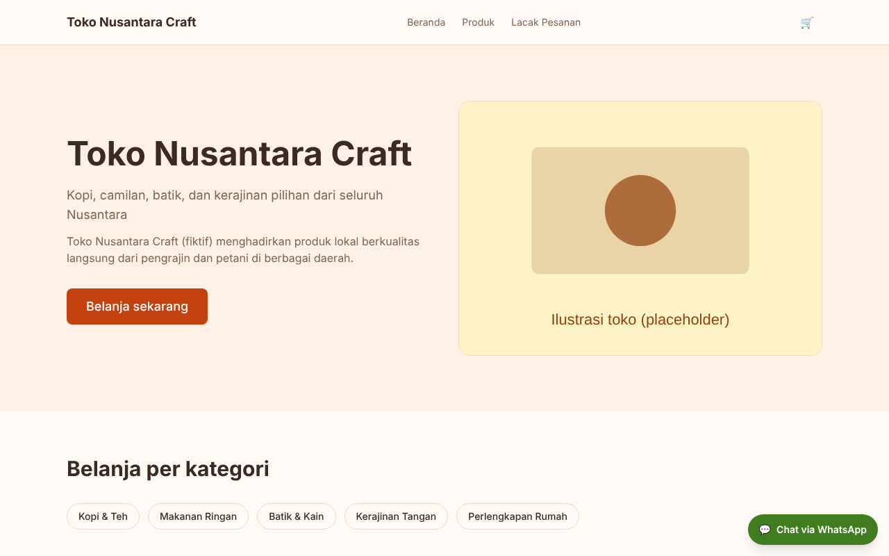
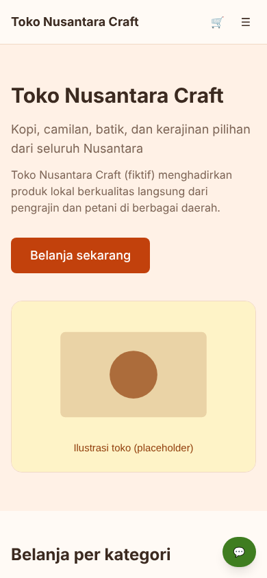
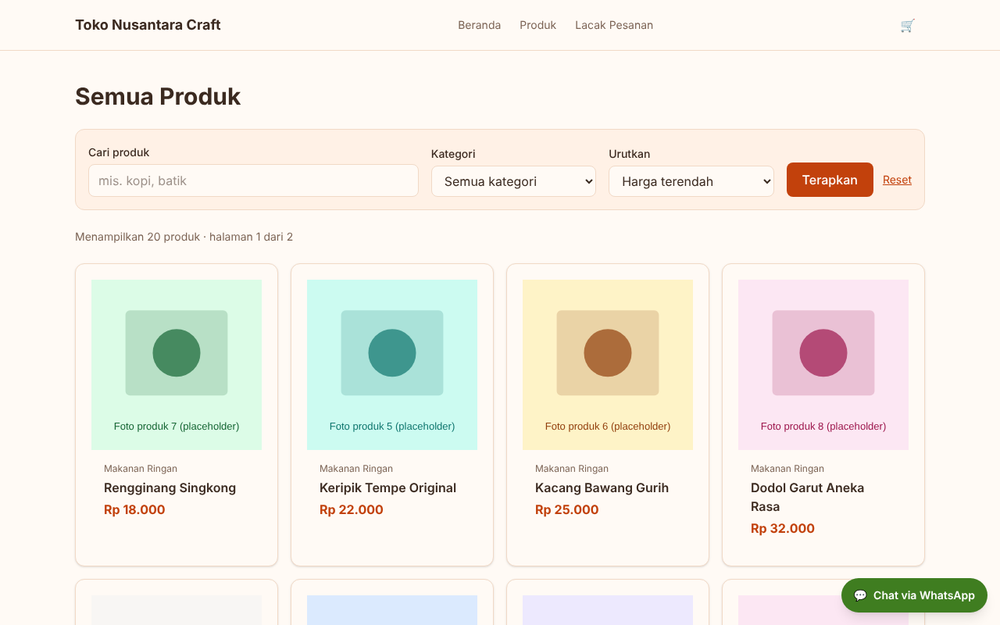
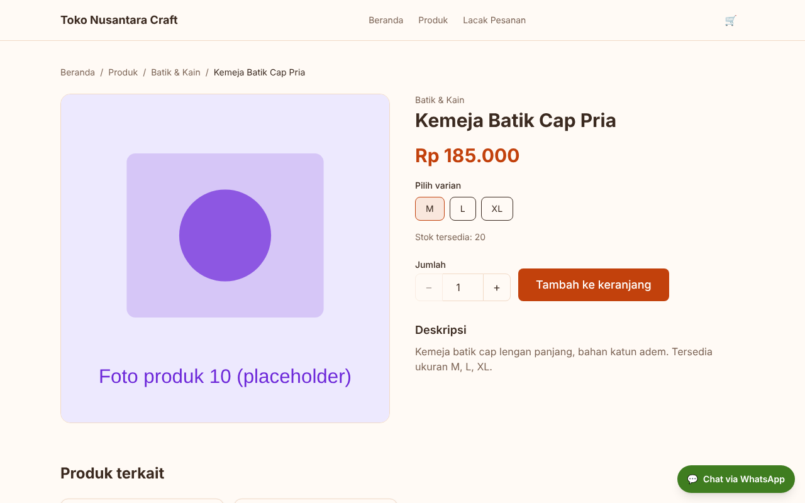
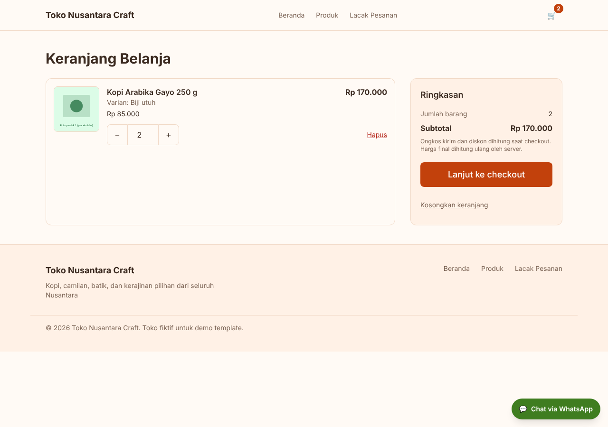
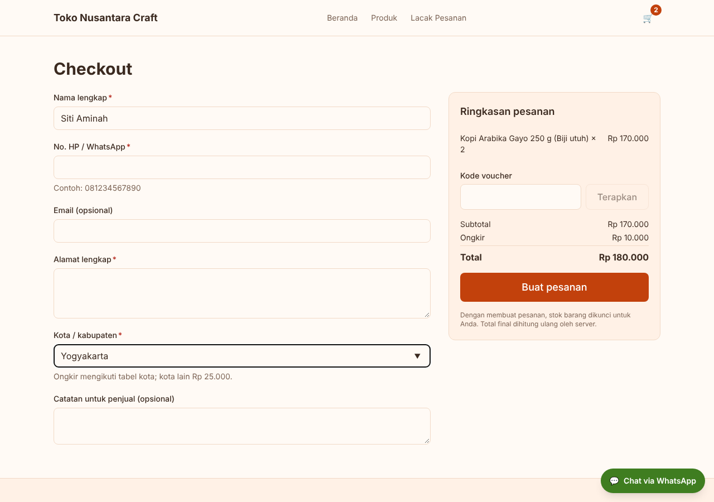
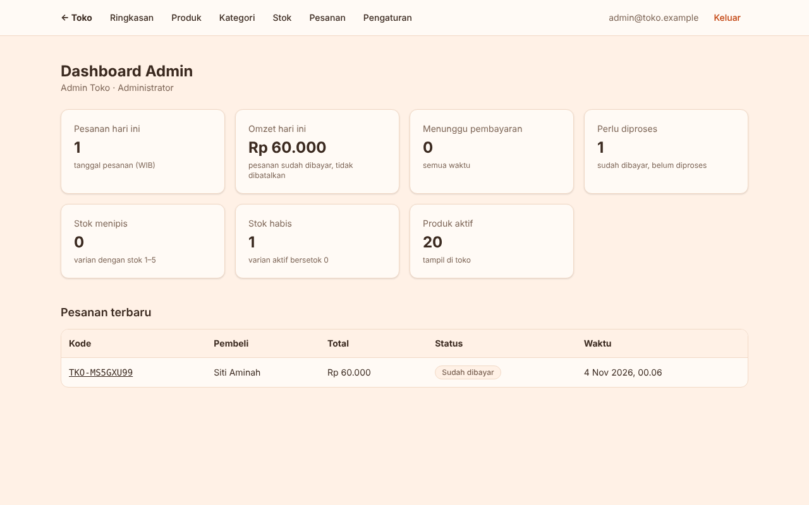
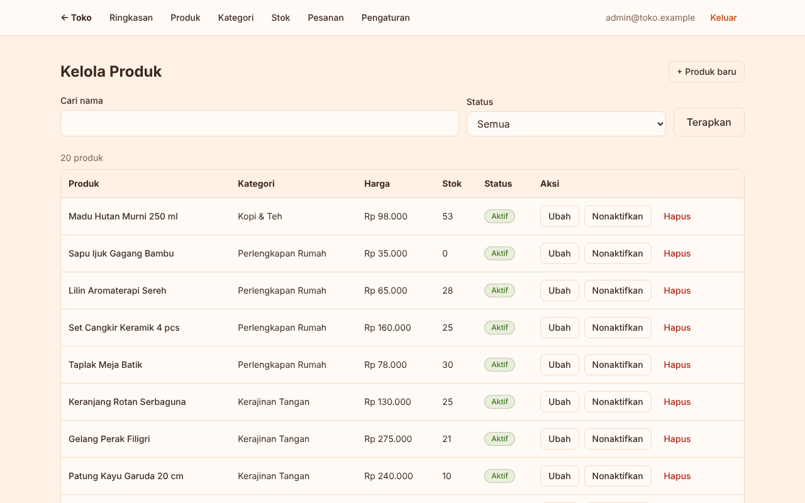
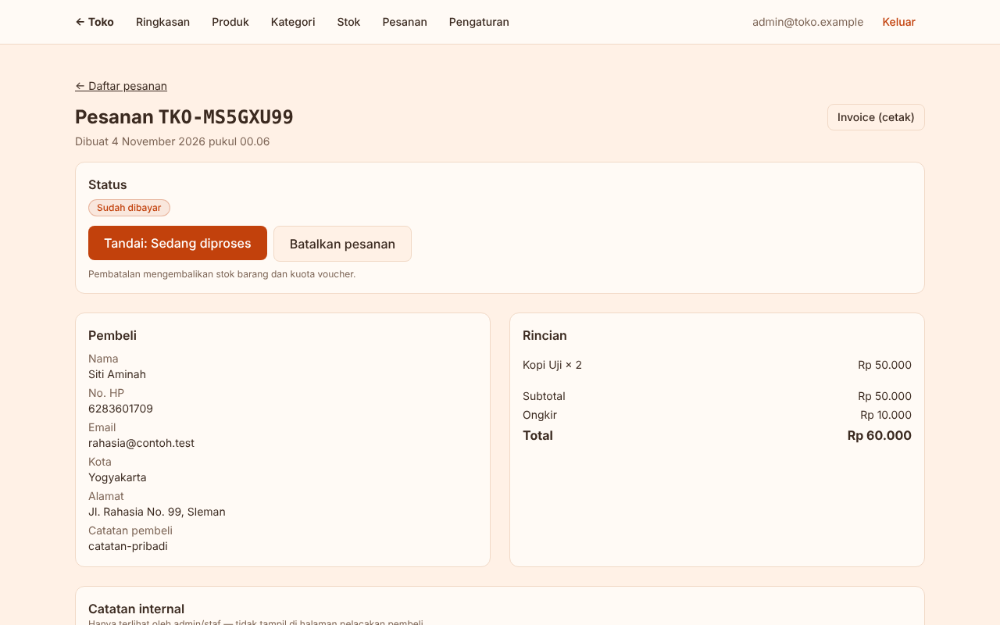
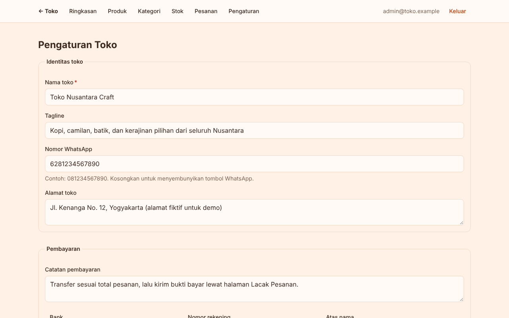

# Toko Online (demo)

Template toko online berbahasa Indonesia. Nama toko, produk, rekening, dan seluruh data demo **fiktif**.

> Status: **lengkap** (T1–T8) — katalog, keranjang, checkout, lacak pesanan, admin produk, admin pesanan & pengaturan, dan QA final.

## Tampilan

| Beranda | Mobile |
|---|---|
|  |  |
|  |  |
|  |  |
|  |  |
|  |  |

Membuat ulang: `cd apps/toko-online && SCREENSHOTS=1 npx playwright test e2e/screenshots.spec.ts --project=fitur`.

## Menjalankan

```bash
# dari root monorepo
npm ci
cp apps/toko-online/.env.example apps/toko-online/.env      # lalu isi ADMIN_PASSWORD (min. 12 karakter)
npm run setup -w @tpl/toko-online                           # prisma generate + migrate + seed demo
npm run dev -w @tpl/toko-online                             # http://localhost:3005
```

## Data

| Model | Isi |
|---|---|
| `User` | Akun admin/staf (password **bcrypt**; dibuat seed dari env — tidak ada password bawaan) |
| `Category`, `Product`, `Variant` | Katalog. Stok **per varian** (tiap produk ≥ 1 varian, mis. "Standar"); varian boleh menimpa harga produk |
| `Order`, `OrderItem` | Pesanan dengan **snapshot** nama & harga saat dibeli (mengubah produk tidak mengubah pesanan lama); kode pesanan acak |
| `Voucher` | Potongan persen/nominal, minimal belanja, maksimal diskon, kuota, masa berlaku |
| `Setting` | Pengaturan toko (kunci–nilai): nama, WhatsApp, rekening, tabel ongkir |

Kolom status/peran bertipe `String` (SQLite tanpa enum); nilai sahnya ada di `lib/domain.ts` dan diuji terhadap `schema.prisma`. Uang = `Int` rupiah.

**Seed** (`prisma/seed.ts`, data di `prisma/seed-data.ts`): idempotent dan **tidak menimpa** baris yang sudah ada. Berisi 5 kategori, 20 produk (33 varian; ada contoh stok habis & harga varian berbeda), 5 voucher (aktif, kedaluwarsa, kuota habis, nonaktif), dan pengaturan awal. Akun dashboard hanya dibuat bila `ADMIN_PASSWORD` / `STAFF_PASSWORD` diisi (≥ 12 karakter). Gambar demo = SVG placeholder di `public/img/`.

## Katalog (T2)

| Halaman | Isi |
|---|---|
| `/` | Hero, kategori, 8 produk terbaru |
| `/produk` | Daftar produk: filter `?kategori=`, pencarian `?q=`, urutan `?urut=terbaru\|termurah\|termahal\|nama`, paginasi `?halaman=` (12/halaman). Form filter memakai GET biasa → jalan **tanpa JavaScript** |
| `/produk/[slug]` | Galeri gambar, pilihan varian (harga & stok mengikuti varian; varian habis tidak bisa dipilih), deskripsi, produk terkait, JSON-LD `Product` |
| `/sitemap.xml`, `/robots.txt` | Hanya produk aktif; `/admin`, keranjang, checkout, lacak tidak diindeks |

Keputusan desain:
- **Hanya produk & varian `active`** yang publik (daftar, pencarian, detail → 404, sitemap). Produk tanpa varian aktif dianggap **habis**.
- Parameter URL divalidasi (`urut`, `halaman`, `kategori`, `q`): nilai aneh diabaikan, bukan error; `halaman` di luar rentang dijepit.
- Pencarian dan pengurutan dilakukan di aplikasi, bukan `contains` Prisma — `contains` **tidak meng-escape wildcard LIKE** (terbukti: `?q=%` mencocokkan semua produk). Cukup untuk katalog skala toko kecil (≤ ribuan produk); untuk katalog besar pindahkan ke FTS5/indeks.
- Galeri: hanya path `/img/…` atau `/uploads/…` yang sah; entri lain (`javascript:`, URL luar) dibuang. Data JSON-LD meng-escape `<`.
- Nama/deskripsi dirender sebagai teks (tidak ada HTML dari data).

## Keranjang (T3)

- Keranjang **client-side** (`localStorage`, kunci `toko.keranjang.v1`) yang hanya menyimpan `{varianId, qty}`. **Harga, nama, dan stok tidak pernah disimpan di klien**: halaman keranjang & mini-cart mengambilnya dari server lewat `POST /api/keranjang` (`{ ids: number[] }`), dan checkout (T4) menghitung ulang semuanya di server.
- Isi `localStorage` dianggap **input tidak tepercaya**: JSON rusak, tipe salah, qty negatif/pecahan/raksasa, properti tambahan (mis. `harga`), duplikat, dan >50 baris dinormalkan/dibuang (`lib/keranjang.ts`, diuji unit).
- Mini-cart di navbar (selalu tampil, termasuk di layar 360 px), badge jumlah, sinkron antar-tab (event `storage`). Penyimpanan diblokir (mode privat) → fallback memori selama tab terbuka.
- Halaman `/keranjang`: ubah jumlah (+/−/ketik; dijepit 1…stok), hapus item, kosongkan (dengan konfirmasi). Produk yang dinonaktifkan / stok habis ditandai dan **tidak dihitung**; jumlah melebihi stok dijepit otomatis.
- `POST /api/keranjang`: hanya `application/json` (415), maks. 4 KB (413), skema ketat (400), 120 permintaan/menit/IP (429 + `Retry-After`, env `KERANJANG_LIMIT`), `Cache-Control: no-store`. Produk/varian nonaktif dijawab `tersedia:false` **tanpa nama/harga**. Endpoint baca-saja.
- `@tpl/ui` `Navbar` mendapat prop opsional `actions` (tampil di bar di luar menu hamburger); aplikasi lain tidak terpengaruh.

## Checkout (T4)

Alur: `/keranjang` → `/checkout` (form pembeli + ringkasan) → konfirmasi (kode pesanan, info pembayaran, tombol WhatsApp).

**Prinsip: server tidak percaya angka dari klien.** Permintaan hanya membawa `{varianId, qty}`, data pembeli, kota, kode voucher, dan `totalPreview`. Harga, ongkir, diskon, dan total dihitung ulang dari DB di satu tempat (`hitungRingkasan`, `lib/checkout-server.ts`).

| Endpoint | Fungsi |
|---|---|
| `POST /api/checkout/ringkasan` | Pratinjau yang dihitung server (baca-saja). 120/menit/IP; yang membawa voucher juga dibatasi 20/10 menit/IP (cegah tebak kode) |
| `POST /api/pesanan` | Buat pesanan. 10/jam/IP dan 6/jam/nomor HP |

Jaminan keamanan & integritas (semuanya diuji e2e, termasuk balapan bersamaan):
- **Skema ketat**: properti asing (`harga`, `total`, `ongkir`, `diskon`, `stok`, `status`, …) → 400, bukan diabaikan diam-diam.
- **`totalPreview` hanya pembanding**: bila beda dari hitungan server (mis. harga/ongkir berubah, atau dimanipulasi) → 409 `harga-berubah`, tidak ada pesanan, ringkasan terbaru dikirim balik.
- **Transaksi atomik**: hitung ulang → kunci stok dengan `UPDATE … WHERE stock >= qty` (stok tak pernah negatif; 8 pesanan bersamaan untuk stok 3 → tepat 3 berhasil) → pakai kuota voucher dengan `UPDATE … WHERE quota IS NULL OR used < quota` → simpan `Order` + `OrderItem` (snapshot nama & harga). Gagal di mana pun → semua dibatalkan.
- **Idempotensi**: `kunci` per percobaan; klik ganda / kirim ulang bersamaan → satu pesanan (in-memory per proses; multi-instance → simpan di DB/Redis).
- **Ongkir** dari tabel manual (`toko.ongkir`): kunci kota dinormalkan (huruf kecil, awalan "Kota/Kab." dibuang); kota lain → tarif bawaan; kunci prototipe (`constructor`, `__proto__`) tidak dianggap tarif.
- **Voucher**: PERSEN (dibulatkan ke bawah, dibatasi `maxDiscount`) / NOMINAL; atas subtotal barang (bukan ongkir), tidak pernah melebihi subtotal; minimal belanja, masa berlaku (inklusif), kuota. Pesan galat **generik** untuk kode tidak ada/nonaktif/kedaluwarsa (tidak membocorkan status kode); hanya "minimal belanja" & "kuota habis" yang spesifik (konsekuensi: kode yang valid bisa dibedakan dari yang tidak — dimitigasi rate limit 20/10 menit).
- **CSRF**: JSON-only (415), `Origin` harus sama dengan host (403), badan ≤ 8 KB (413).
- **Anti-bot**: honeypot (tampak sukses, tidak menyimpan apa pun), batas per-IP & per-nomor.
- Total maksimum Rp 1 miliar (Prisma `Int` 32-bit). Data pembeli disanitasi (HTML dibuang); telepon dinormalkan ke `62…`.
- Konfirmasi ditampilkan **di halaman yang sama** (tanpa URL per-pesanan yang bisa ditebak); pelacakan lewat kode + nomor HP (T5). Tombol WhatsApp berupa tautan yang diklik pengguna (bukan redirect otomatis — WCAG 3.2.5).
- **Risiko yang diketahui**: stok dikunci saat pesanan dibuat, sehingga pesanan palsu bisa "menahan" stok. Mitigasi: batas laju + pembatalan oleh admin mengembalikan stok (T7).
- QRIS di demo = gambar placeholder (`/img/qris.svg`), bukan kode QR sungguhan.

## Lacak pesanan & bukti bayar (T5)

`/lacak` — pembeli memasukkan **kode pesanan + nomor HP** yang dipakai saat checkout (tautan di halaman konfirmasi sudah mengisi kode).

| Endpoint | Fungsi |
|---|---|
| `POST /api/lacak` | Status & rincian pesanan. 10/15 menit/IP dan 8/15 menit/kode |
| `POST /api/lacak/bukti` | Unggah/ganti bukti bayar (multipart). 5/jam/IP dan 5/jam/kode |

- **Otorisasi = kode + HP cocok.** Semua kegagalan (kode tak ada, HP salah, format salah) dijawab **identik** (404 "Kode pesanan atau nomor HP tidak cocok") dan perbandingan HP waktu-konstan → tidak membocorkan apakah suatu kode ada. Kode acak 8 karakter dari 31 simbol (~8,5×10¹¹ kemungkinan).
- Respons hanya memuat yang perlu: status, rincian barang, biaya, nama, kota. **Tidak** ada HP, email, alamat, catatan pembeli, catatan admin, atau nama berkas bukti. Info rekening hanya saat `MENUNGGU_BAYAR`.
- **Bukti bayar**: hanya saat `MENUNGGU_BAYAR` (lainnya 409; update-nya bersyarat status sehingga tidak berbalapan dengan admin). Validasi **magic bytes** (PNG/JPEG/WebP/PDF), ≤ 2 MB, MIME harus cocok isi; SVG/HTML/GIF/PHP/EXE ditolak meski dinamai `.png`. Nama berkas dibuat server (acak), disimpan di `UPLOAD_DIR/bukti/` — **tidak disajikan oleh route publik mana pun** (viewer admin dibuat di T7). Mengganti bukti menghapus berkas lama; kegagalan menyimpan DB membersihkan berkas baru.
- Badan permintaan dibaca dengan **batas keras** (stream dihentikan melewati ~2 MB; tidak menampung badan raksasa), `Origin` lintas-situs → 403.
- **Konsekuensi yang diketahui:** batas per-kode berarti pihak lain bisa menghabiskan 8 percobaan/15 menit untuk kode yang ia ketahui sehingga pembeli asli tertahan sementara (kompromi yang sama dengan cek status PPDB).

## Admin (T6)

Login: `/admin/login` (NextAuth v4, credentials + bcrypt). Akun dibuat `npm run setup` dari `ADMIN_EMAIL`/`ADMIN_PASSWORD` dan `STAFF_PASSWORD` (≥ 12 karakter; **tidak ada password bawaan**). Tanpa `NEXTAUTH_SECRET` (≥ 32 karakter) login nonaktif (fail closed).

| Peran | Akses |
|---|---|
| `ADMIN` | semua: ringkasan, produk, kategori, stok, pesanan, pengaturan |
| `STAFF` | ringkasan, stok, pesanan — **tidak** boleh mengubah produk/harga, kategori, atau pengaturan (rekening pembayaran) |

Pertahanan berlapis: `proxy.ts` menolak `/admin/*` & `/api/admin/*` tanpa JWT (gerbang pertama), **lalu** setiap halaman, server action, dan route handler memeriksa ulang sesi **ke DB** — akun yang dihapus atau diturunkan perannya kehilangan akses seketika, dan hak mengikuti peran di DB (bukan klaim token). Cookie sesi `httpOnly` + `SameSite=Strict`, 8 jam. Login dibatasi 10 percobaan/15 menit/IP (+ batas longgar per akun); galat login identik untuk email tak terdaftar/password salah; `callbackUrl` hanya path `/admin…` (anti open redirect).

| Halaman | Fungsi |
|---|---|
| `/admin` | Dasbor: pesanan hari ini (WIB), omzet hari ini (hanya pesanan dibayar/diproses/dikirim/selesai), menunggu bayar, perlu diproses, stok menipis/habis, 5 pesanan terbaru |
| `/admin/produk` | Daftar (cari, filter status), tambah/ubah (nama, kategori, harga, deskripsi, gambar utama + galeri ≤ 8, **varian**: nama/SKU/harga/stok awal/aktif), aktifkan/nonaktifkan, hapus |
| `/admin/kategori` | CRUD; slug dibuat otomatis (unik) dan **tidak berubah** saat nama diganti; kategori berisi produk tidak bisa dihapus |
| `/admin/stok` | Penyesuaian stok per varian sebagai **selisih** (+/−), atomik; hasil tak boleh < 0 |

Keputusan desain:
- **Stok diubah sebagai selisih, bukan nilai mutlak**, dan stok varian yang sudah ada **tidak ikut disimpan dari form produk**: menimpa nilai mutlak akan menghapus pengurangan oleh pesanan yang masuk saat form terbuka (terbukti di tes).
- Unggah gambar: magic bytes PNG/JPEG/WebP ≤ 2 MB, MIME harus cocok isi; SVG/GIF/HTML/PHP ditolak; nama dibuat server; semua berkas diperiksa **sebelum** ada yang ditulis; disajikan lewat `/uploads/[nama]` (regex ketat, `nosniff`, CSP `sandbox`) dari folder di luar `public/`. Berkas dibersihkan hanya bila tak dirujuk lagi (produk lain/pengaturan).
- Varian yang dikirim harus milik produk yang sedang diubah (ID produk lain ditolak); SKU unik di seluruh toko.
- Menghapus produk/varian tidak merusak riwayat pesanan (`OrderItem` menyimpan snapshot nama & harga; relasi `SetNull`).

## Admin pesanan & pengaturan (T7)

| Halaman | Peran | Fungsi |
|---|---|---|
| `/admin/pesanan` | ADMIN, STAFF | Daftar (cari kode/nama/HP, filter status, 25/halaman) |
| `/admin/pesanan/[id]` | ADMIN, STAFF | Detail, ubah status, catatan internal, lihat bukti bayar |
| `/admin/pesanan/[id]/invoice` | ADMIN, STAFF | Invoice A4 siap cetak (menu admin disembunyikan saat cetak) |
| `/admin/pesanan/ekspor[?status=]` | **ADMIN saja** | CSV pesanan (memuat data pribadi massal → area `laporan`) |
| `/admin/pengaturan` | **ADMIN saja** | Nama, tagline, WhatsApp, alamat, rekening (≤ 5), QRIS, tarif ongkir (bawaan + ≤ 50 kota) |

Status pesanan: `MENUNGGU_BAYAR → DIBAYAR → DIPROSES → DIKIRIM → SELESAI`; **dibatalkan** boleh selama belum dikirim. `SELESAI` dan `DIBATALKAN` final. Peta transisi satu-satunya ada di `lib/status.ts` (diuji).

Jaminan integritas:
- **Compare-and-set**: form membawa status yang dilihat admin (`dari`); server menolak bila status di DB sudah berbeda (dua admin / klik ganda tidak saling menimpa) atau transisinya tidak sah — juga bila permintaan dibuat tanpa UI.
- **Pembatalan mengembalikan stok tiap item dan kuota voucher tepat sekali** (dalam satu transaksi; 3 permintaan batal serentak → stok kembali sekali). Varian yang sudah dihapus dilewati.
- Bukti bayar disajikan hanya ke sesi admin/staf, dengan `nosniff`, CSP `sandbox`, `no-store`; tidak ada rute publik.
- CSV: sel berawalan `=` `+` `-` `@` dinetralkan, BOM UTF-8, maks 5.000 baris.
- Pengaturan: semua nilai divalidasi ulang di server dan JSON dibangun dari data tervalidasi (bukan dari klien); nama kota dinormalkan & dicek unik, nama berbahaya (`__proto__`, `constructor`, …) ditolak; WA dinormalkan ke `62…`; QRIS lewat validasi unggahan yang sama dengan gambar produk; berkas QRIS lama dibersihkan bila tak dirujuk.
- Pencarian admin: wildcard (`%`, `_`, `\`) dicari sebagai teks biasa; kata kunci yang hanya berisi wildcard tidak cocok apa pun.
- Voucher dikelola lewat seed/DB (UI voucher di luar cakupan template ini).

## Akun demo

Akun dibuat oleh `npm run setup` **hanya bila** password diisi di `.env` (min. 12 karakter; tidak ada password bawaan):

| Peran | Email | Password dari |
|---|---|---|
| ADMIN | `admin@toko.example` (atau `ADMIN_EMAIL`) | `ADMIN_PASSWORD` |
| STAFF | `staf@toko.example` | `STAFF_PASSWORD` |

Voucher demo (seed): `HEMAT10` (10%, min Rp 100.000, maks Rp 50.000), `POTONG25K` (Rp 25.000, min Rp 200.000, kuota 100); `KADALUARSA`, `HABIS`, `NONAKTIF` untuk menguji penolakan.

## Hasil QA final (T8)

`e2e/qa.spec.ts` dan `e2e/admin-qa.spec.ts` merangkum pemeriksaan lintas-fitur:
- **Halaman publik** (beranda, katalog + filter, semua produk seed, keranjang, checkout, lacak, login admin): 200 tanpa error konsol/CSP, tanpa aset 4xx, **tanpa permintaan ke domain luar**; gambar termuat, ber-`alt`, dimensi/rasio tetap (anti layout shift); tanpa overflow horizontal di 360/768/1280 px.
- **Aksesibilitas**: satu `h1`, heading tanpa lompat, landmark banner/main/footer, `lang="id"`, id unik, semua tautan/tombol/input bernama, Tab pertama = lewati-konten, indikator fokus, target sentuh ≥ 24 px (termasuk tombol keranjang), **kontras WCAG AA untuk ketiga tema**.
- **Keamanan**: manipulasi harga/qty/total di request (ditolak/dihitung ulang server), akses pesanan orang lain (kode + HP harus cocok; galat identik), unggah berbahaya (SVG/HTML/PHP/GIF/EXE, MIME palsu, > 2 MB) di produk, QRIS, dan bukti bayar, balapan stok & kuota voucher, CSRF (Origin/Content-Type), rate limit, header keamanan di semua jenis rute, tak ada kebocoran jejak teknologi di galat.
- **Otorisasi**: matriks anonim / STAFF / ADMIN atas **semua** halaman dan route admin (termasuk metode tulis dan memutar ulang ID server action milik admin tanpa sesi).
- **Alur lengkap lintas peran**: admin membuat produk → pembeli menelusuri, checkout dengan voucher, lacak, unggah bukti → admin verifikasi dan memproses hingga selesai → pembeli melihat "Selesai"; invoice, CSV, dasbor, dan stok konsisten. Plus alur pembatalan (stok & voucher kembali).
- **Temuan QA & perbaikan** selama T8: tautan brand navbar hanya 21 px tinggi (< 24 px) → 44 px; nilai rupiah dan tombol "Terapkan" terpecah di kolom sempit karena `overflow-wrap: anywhere` global → `whitespace-nowrap`.

## Pengujian

```bash
npm run test -w @tpl/toko-online        # unit (Vitest)
npm run test:e2e -w @tpl/toko-online    # e2e (Playwright; DB e2e dibuat ulang tiap run)
```
