# Undangan Digital (demo)

Template undangan digital berbahasa Indonesia untuk **pernikahan, aqiqah, dan khitanan** — dengan 3 tema, RSVP, ucapan & doa, amplop digital, dan panel admin. Nama, tanggal, alamat, rekening, dan QRIS di dalamnya **fiktif/placeholder**.

| Sampul + nama tamu | Mempelai | Detail acara |
|---|---|---|
| 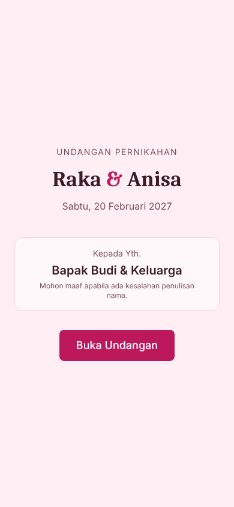 | 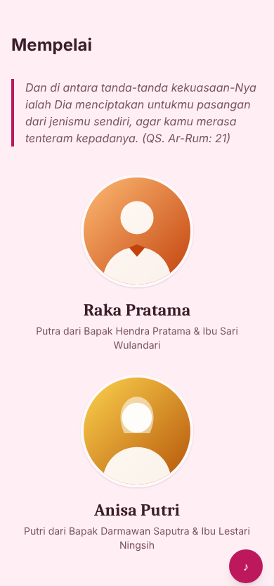 | 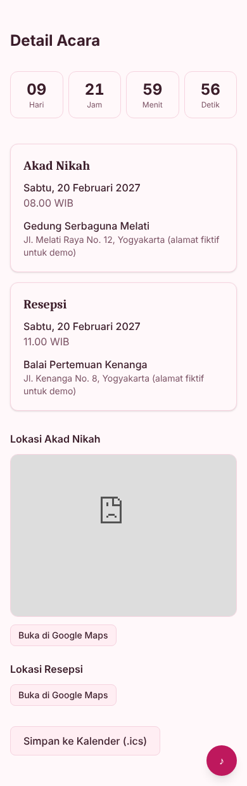 |

| Galeri | Amplop digital | RSVP |
|---|---|---|
| 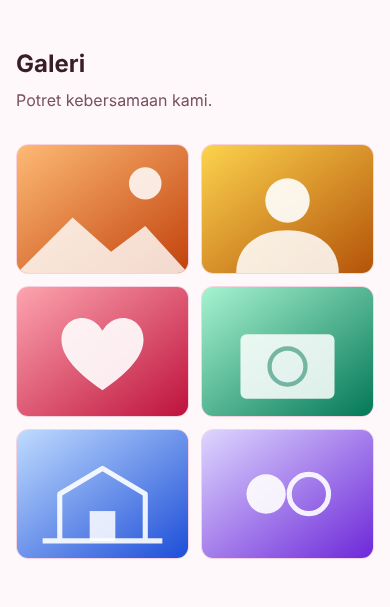 | 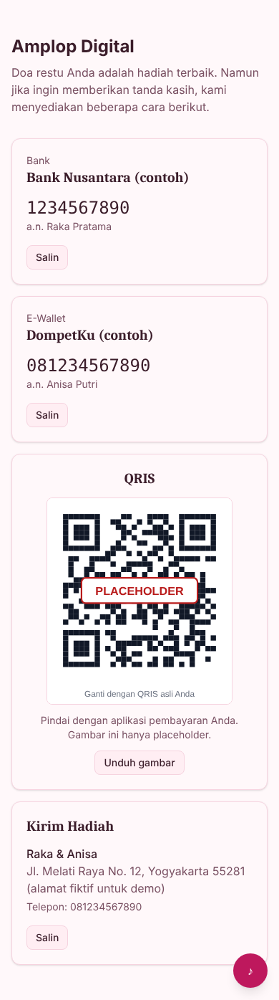 | 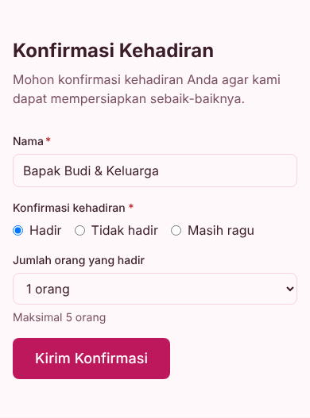 |

**Tema & jenis acara** — floral/pernikahan, islami/aqiqah, elegan/khitanan:

| Floral | Islami | Elegan |
|---|---|---|
| 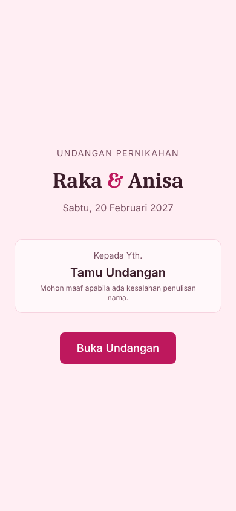 | 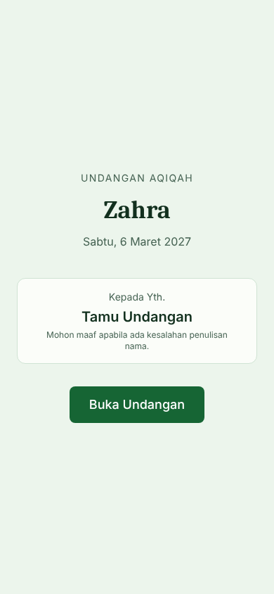 | 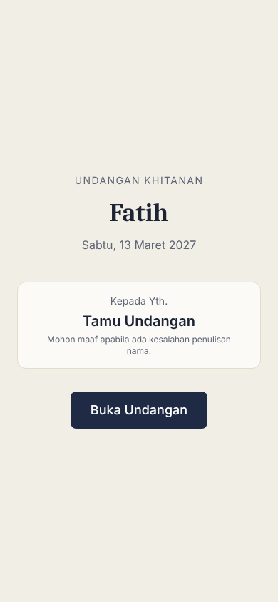 |

**Admin** — ringkasan, tamu & tautan pribadi, moderasi ucapan:

| Ringkasan | Tamu & tautan | Moderasi ucapan |
|---|---|---|
| 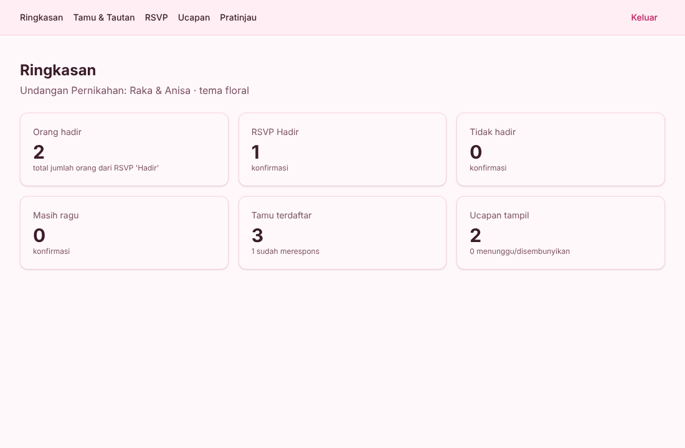 | 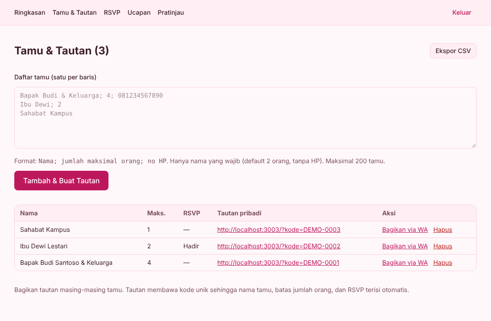 | 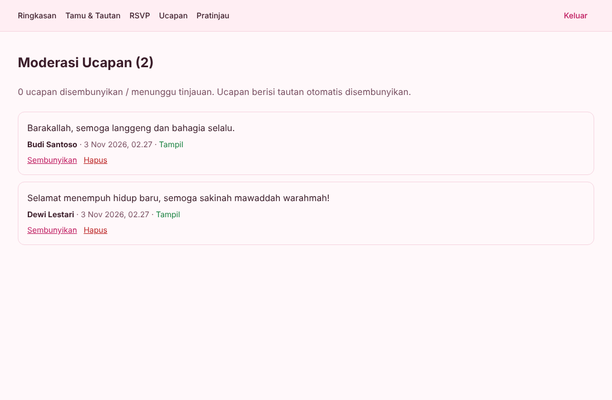 |

## Alur pemakaian

1. Siapkan data acara (lihat bagian *Data acara*), lalu atur `EVENT_SLUG`.
2. Buka `/admin` → **Tamu & Tautan** → tempel daftar tamu → bagikan tautan pribadi tiap tamu (WhatsApp).
3. Tamu membuka tautan → sampul dengan namanya → **Buka Undangan** → baca → RSVP & ucapan.
4. Pantau **Ringkasan/RSVP**, moderasi **Ucapan**, ekspor CSV untuk katering/data.

## Menjalankan

```bash
# dari root monorepo
npm ci
cp apps/undangan/.env.example apps/undangan/.env
npm run setup -w @tpl/undangan   # prisma generate + migrasi + seed acara demo
npm run dev -w @tpl/undangan     # http://localhost:3003
```

## Nama tamu di sampul

Kirim tautan berbeda per tamu dengan parameter `to`:

```
http://localhost:3003/?to=Bapak%20Budi%20%26%20Keluarga
```

Nama dibersihkan (tag HTML & karakter kontrol dibuang), dipotong 60 karakter, dan dirender sebagai teks. Tanpa `to` tampil "Tamu Undangan".

## Musik latar

Pemutar memakai `public/audio/latar.wav`. **File bawaan adalah placeholder senyap** (2 detik, ±16 KB) karena template tidak mengunduh aset dari luar.

Mengganti musik:

1. Siapkan lagu yang Anda punya hak pakainya (milik sendiri / berlisensi bebas). Format MP3 atau M4A disarankan, ≤ 3 MB.
2. Simpan di `public/audio/` (mis. `latar.mp3`).
3. Ubah nilai default `audioSrc` di `components/Cover.tsx` (atau kirim prop `audioSrc` dari `app/page.tsx`).

Musik baru mulai setelah tamu menekan **Buka Undangan** (kebijakan autoplay browser); tombol musik di kanan bawah untuk menyalakan/mematikan.

## Jenis acara & tema

Tiap acara (tabel `Event`) punya kolom `jenis` dan `tema`:

| `jenis` | Tampilan |
|---|---|
| `pernikahan` | dua mempelai, Akad Nikah + Resepsi, kisah cinta |
| `aqiqah` | satu profil ("Si Kecil"), satu sesi "Acara Aqiqah" |
| `khitan` | satu profil ("Yang Dikhitan"), satu sesi "Acara Khitanan" |

| `tema` | Kesan |
|---|---|
| `elegan` | navy & emas |
| `floral` | mawar |
| `islami` | hijau & emas |

Seed membuat 3 acara demo (`raka-anisa`, `aqiqah-demo`, `khitan-demo`). Acara yang tampil untuk publik dipilih env `EVENT_SLUG`. Palet ada di `app/tema.css` (semua pasangan teks/latar lolos WCAG AA; diuji otomatis). Untuk acara baru, tambahkan baris `Event` (lewat seed/SQL) dengan `jenis` & `tema` pilihan Anda.

## Admin

`/admin` (password dari env `ADMIN_PASSWORD`; wajib juga `ADMIN_SESSION_SECRET` ≥ 32 karakter — bila kosong login nonaktif):

- **Ringkasan** — jumlah RSVP (hadir/tidak/ragu), total orang hadir, tamu terdaftar, ucapan.
- **Tamu & Tautan** — tempel daftar tamu (`Nama; jumlah maks; no HP`, satu per baris, maks 200) → dibuat kode & tautan pribadi `/?kode=…`, tombol bagikan WhatsApp, hapus, ekspor CSV. Satu baris salah menolak seluruh pengiriman (tidak ada yang tersimpan).
- **RSVP** — rekap + ekspor CSV.
- **Ucapan** — moderasi: tampilkan / sembunyikan / hapus. Ucapan berisi tautan otomatis disembunyikan; env `WISH_MODERATION=on` menahan semua ucapan sampai disetujui.
- **Pratinjau** — lihat acara/tema lain secara baca-saja.

Cookie sesi bernama `undangan_admin` (berbeda dari app lain karena cookie dibagi lintas port di `localhost`). CSV menetralkan formula injection.

## Data acara

Data acara ada di database (tabel `Event`, lihat `prisma/schema.prisma`). Demo di-seed oleh `prisma/seed.ts` (aman dijalankan berulang: `npm run db:seed -w @tpl/undangan`). Slug acara yang tampil diatur env `EVENT_SLUG`. Ganti DB ke MySQL/PostgreSQL: lihat [`docs/CARA-MODIF.md`](../../docs/CARA-MODIF.md) §6.

## Pengujian

```bash
npm run test -w @tpl/undangan        # unit (Vitest)
npm run test:e2e -w @tpl/undangan    # e2e (Playwright, DB e2e sekali pakai)
```

Cakupan e2e: alur tamu lengkap di viewport ponsel (tanpa error konsol/pelanggaran CSP), **XSS** (`?to=`, ucapan, dan data "kotor" yang disuntik langsung ke DB — semua harus tampil sebagai teks), RSVP/ucapan (validasi, honeypot, rate limit, moderasi), cover & musik, Maps/kalender/amplop, admin (akses, tamu massal, moderasi, CSV anti-formula), jenis acara & tema (termasuk kontras WCAG AA), aksesibilitas dasar, dan tidak ada overflow di 360/768/1280 px.

Membuat ulang screenshot di atas:

```bash
cd apps/undangan && SCREENSHOTS=1 npx playwright test e2e/screenshots.spec.ts
```

Tanpa unduhan browser: tambahkan `PW_CHROMIUM_PATH=/path/ke/chromium`.
